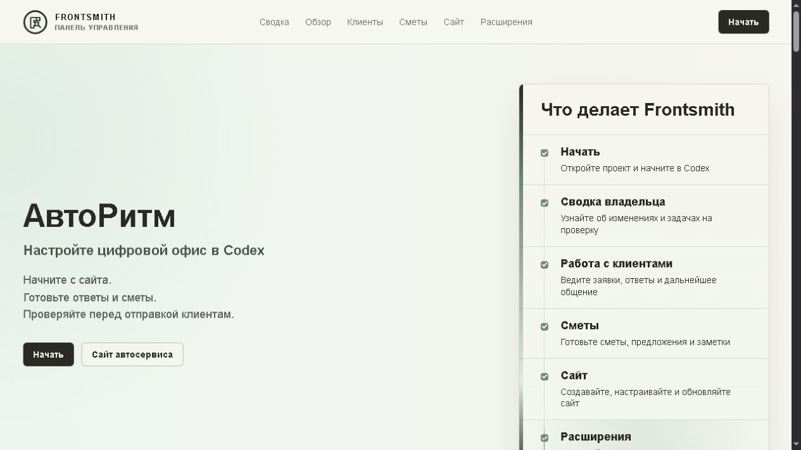

# Frontsmith

Frontsmith v1.0 — цифровой офис с открытым исходным кодом для местных компаний, оказывающих услуги. Он создан для работы через Codex.

Оператор получает единую рабочую область: один раз настраивает компанию, затем ведёт её цифровой офис — обращения клиентов, черновики ответов, повторные контакты, сметы, коммерческие предложения, обновления сайта, проверки запуска, историю действий и подключения с обязательным согласованием.

Оператор работает через Codex: обновляет сведения о компании, просматривает Сводку владельца, готовит ответы клиентам и сметы, проверяет сайт и черновики, согласует готовые материалы и совершенствует цифровой офис по мере изменений в бизнесе.

Основной интерфейс Frontsmith — чат в Codex, за которым стоят файлы репозитория и локальные скрипты. Рабочий цикл:

```text
владелец пишет запрос в Codex
  -> Frontsmith читает локальные записи компании
  -> Codex возвращает оформленную сводку, черновик, план или контрольный список
  -> владелец проверяет созданный материал
  -> согласованные изменения обновляют файлы, сайт или черновики действий в подключённых сервисах
```

## Предпросмотр

Панель демонстрации для знакомства с продуктом:



Текущий учебный цифровой офис — автосервис «АвтоРитм». Восемь услуг, демонстрационные цены, расписание и политика согласования находятся в `blueprints/auto-service/business.example.json`. `npm run bootstrap` создаёт приватную рабочую копию в `.frontsmith/business/`; повторный запуск не заменяет существующий профиль без явного указания.

Сайт автосервиса запускается командой `npm run preview:website` по адресу `http://localhost:4173`. Кнопки записи открывают `https://example.com/booking`. Это внешняя ссылка, без импорта записей и синхронизации. Локальная форма только проверяет заполнение. Контакты, цены и изображение — учебные примеры, не подтверждённые сведения действующего бизнеса.

Включённый в проект сайт автосервиса:


Материалы для знакомства с проектом, в том числе для ИИ:

- [Демонстрация рабочих процессов](docs/walkthroughs/codex-workflow-proof.md) — запросы, команды и результаты работы цифрового офиса
- [Краткая сводка для ИИ](demo/llms.txt) — назначение проекта, структура и запуск
- [Архитектура Frontsmith](docs/product/architecture.md) — устройство проекта и границы модулей
- [Локальная карта согласований и Relay](docs/product/relay-proof-map.md) — подготовка и проверка внешних действий

Интерактивная демонстрация тоже включена в репозиторий: выполните `npm run preview:demo` и откройте [локальный обзор](http://localhost:4174/#walkthrough). Исходное видео на английском, русские субтитры включены. Будущие русскоязычные материалы на домене проекта пока не опубликованы; перечисленные документы доступны локально и на GitHub.

В метаданных, сборке, `robots.txt` и `sitemap.xml` используется `https://codex-frontsmith.example/` — заглушка будущего русскоязычного сайта, а не действующий адрес. Перед публикацией замените её на выбранный домен. Редиректы на сайт исходного проекта отключены.

## Попробуйте Frontsmith

Frontsmith готов к обратной связи от разработчиков, агентств и операторов.

Быстрый практический тест:

```bash
git clone https://github.com/vionaaru/codex-frontsmith.git
cd codex-frontsmith
npm install
npm run check
npm run bootstrap
npm run first-run:status
npm run owner:brief
npm run prepare:connected-action -- --action-type "email" --title "Отправить письмо после консультации" --target "Повторный контакт с клиентом" --evidence "Заметки о клиенте, предоставленные владельцем"
```

Затем расскажите о результате в обсуждении GitHub:

- [Обратная связь разработчика после первого запуска](https://github.com/vionaaru/codex-frontsmith/issues/5).
- [Мнение агентства или оператора: подходит ли проект реальному бизнесу услуг](https://github.com/vionaaru/codex-frontsmith/issues/6).
- [Одно конкретное улучшение, которое упростит внедрение](https://github.com/vionaaru/codex-frontsmith/issues/7).

Начните здесь:

- [Руководство по пробному запуску](docs/community/activation-sprint.md)
- [Начало работы для оператора](docs/operator/start-here.md)
- [Как участвовать в разработке](CONTRIBUTING.md)

## Как устроен продукт

```text
репозиторий GitHub
  -> открыть в Codex
  -> настроить рабочую область компании
  -> вести общение с клиентами
  -> просмотреть Сводку владельца
  -> настроить включённый в проект сайт
  -> подготовить сметы и предложения
  -> открыть локальный предпросмотр
  -> при необходимости изучить онлайн-Панель демонстрации
  -> подключить согласованные интеграции
  -> опубликовать согласованный сайт
  -> продолжить работу через процессы Codex
```

Frontsmith хранит рабочие данные отдельно от публичного сайта: `.frontsmith/business/` предназначен для приватных записей компании, а `website/` — для сайта, готового к публикации.

Локальная Панель демонстрации Frontsmith для АвтоРитм открывается по адресу `http://localhost:4174` после `npm run preview:demo`. Сайт автосервиса доступен по пути `/website` как клиентская часть общего рабочего процесса цифрового офиса.

Онлайн-Панель демонстрации знакомит с работой через Codex; сама работа происходит в Codex. Панель показывает посетителю запросы, ответы Frontsmith, созданные Markdown-материалы, изменения локальных файлов, предпросмотры и согласование владельцем перед действиями во внешних сервисах.

## Что входит в комплект

Frontsmith v1.0 включает основные возможности цифрового офиса компании услуг:

- Настройка компании
- Сводка владельца
- Сайт
- Работа с клиентами
- Постоянное общение с клиентами
- Сметы и коммерческие предложения
- Журнал действий
- Настройки и подключения
- Планирование расширений

## Быстрый старт

Откройте репозиторий в Codex и напишите:

```text
Настрой Frontsmith для моей компании, оказывающей услуги в нашем регионе.
```

Codex создаст локальную рабочую область компании, подготовит Сводку владельца, обновит включённый в проект сайт и запустит регулярный рабочий цикл цифрового офиса: черновики ответов клиентам, заметки о повторных контактах, сметы и предложения, проверки запуска и согласуемые шаги подключения публикации, почты, файлового хранилища и инструментов записи.

При замене демонстрационных данных Acme данными реальной компании попросите Codex выполнить:

```bash
npm run first-run:status
```

Команда создаёт `.frontsmith/business/launch/first-run-readiness.md`. В нём видно, какие поля профиля компании настроены, какие ещё похожи на заглушки, какие рабочие файлы существуют и какие действия перед запуском требуют согласования владельца.

Сводка владельца показывает текущее состояние одной компании: что изменилось, что ожидает проверки, что заблокировано, что требует согласования и что делать дальше.

Модуль «Работа с клиентами» поддерживает постоянное общение. После публикации сайта он объединяет обращения, черновики ответов, заметки о повторных контактах, следующие шаги по сметам и согласования владельца.

Подключения и развёртывание требуют согласования. Frontsmith готовит необходимые материалы, но подключает аккаунты, публикует сайт и отправляет сообщения клиентам только после явного согласования владельца.

Пример работы через Codex находится в `docs/walkthroughs/codex-workflow-proof.md`. Он показывает Сводку владельца, черновик ответа клиенту, подготовку сметы, обновление и предпросмотр сайта, планирование расширений, запись подключённого действия, созданные файлы, ссылки предпросмотра и границы согласования.

Карта проверок Frontsmith Relay находится в `docs/product/relay-proof-map.md`. Она связывает ответы клиентам, сметы, обновления сайта, состояние запуска, планы расширений и записи подключённых действий с принципом проверки полномочий до действия, который обеспечивает Neura Relay в режиме подключённого клиента.

Перед выполнением предлагаемого действия Frontsmith может подготовить запись пробного прогона, ещё до запуска адаптера:

```bash
npm run prepare:connected-action -- --action-type "email" --title "Отправить письмо после консультации" --target "Повторный контакт с клиентом" --evidence "Заметки о клиенте, предоставленные владельцем"
```

Команда сохраняет в `.frontsmith/business/connected-actions/...` записи Markdown и JSON: предлагаемое действие, требование согласования, поля для ссылок на Neura Registry и Relay, заблокированные адаптеры и границу, исключающую выполнение реального действия.

Готовый к публикации сайт уже включён в Frontsmith:

```text
website/
```

Это каталог статического сайта. В `website/` находятся HTML, CSS, JavaScript, значки сайта, логотипы и будущие локальные изображения. Приложение Next.js не требуется.

При настройке Codex переносит на одностраничный сайт название компании, адрес сайта, основные услуги, контакты, оформление, изображения, поисковые метаданные и данные для соцсетей. Изменение названия компании обновляет профиль и содержимое сайта; путь к каталогу сайта остаётся прежним.

По умолчанию фотографии загружаются по URL из поля `media` профиля компании. Их можно заменить локальными файлами в `website/assets/`, указав в полях медиа пути `/assets/...`.

Онлайн-Панель демонстрации Frontsmith использует `demo/` как точку входа и копирует `website/` в собранную демонстрацию по пути `/website`.

## Команды для разработчиков

Оператор может поручить выполнение команд Codex. Разработчик может запускать их самостоятельно:

```bash
npm run check
npm run bootstrap -- --business-name "Acme" --website-url "https://business.example"
npm run owner:brief
npm run prepare:reply -- --name "Клиент" --project "Ремонт кухни" --notes "Клиенту нужна помощь с планированием следующего шага."
npm run prepare:estimate -- --project "Ремонт кухни" --scope "Шкафы, столешницы, освещение и уточнение планировки."
npm run prepare:extension -- --capability "Запись на консультации" --connector "Google Calendar" --goal "Подготовить процесс записи по согласованным заявкам с проверкой владельцем."
npm run prepare:connected-action -- --action-type "email" --title "Отправить письмо после консультации" --target "Повторный контакт с клиентом" --evidence "Заметки о клиенте, предоставленные владельцем"
npm run first-run:status
npm run update:website
npm run launch:status
npm run build:demo
npm run preview:demo
npm run deploy:check
npm run preview:website
```

Корневой `vercel.json` задаёт Vercel режим статического сайта и сборку онлайн-Панели демонстрации Frontsmith в `dist/frontsmith-demo`. Для этой публикации Frontsmith не требует `next.config`, `src/app` или сборки Next.js.

`npm run deploy:check` проверяет готовность к развёртыванию, но не публикует сайт. Команда проверяет сборку демонстрации, включённый сайт, настройки статического сайта Vercel, корректные URL, поисковые метаданные и данные для соцсетей, иконки, используемые ресурсы, подключение API контактной формы и обязательные переменные окружения для доставки писем на рабочем сайте. Пока Resend и переменные контактной формы не настроены, команда завершается со списком препятствий. Она не отправляет письма и не развёртывает сайт.

## Автоматическая проверка запуска

Запросы на слияние и отправки изменений в `main` запускают проверку GitHub Actions из `.github/workflows/launch-gate.yml`.

Проверка устанавливает зависимости с Node.js 20, запускает `npm run check`, собирает онлайн-демонстрацию командой `npm run build:demo` и выполняет `npm test`.

`npm run deploy:check` остаётся локальной ручной проверкой, поскольку проверяет настройки доставки заявок на рабочем сайте. Запускайте её с безопасными демонстрационными переменными окружения либо с согласованными настройками доставки, принадлежащими компании. Проверка GitHub Actions не развёртывает сайт, не отправляет письма, не меняет DNS, не обращается к поставщикам услуг и не выполняет действия для клиентов.

## Доставка заявок из контактной формы

Контактная форма сайта отправляет данные на:

```text
/api/contact
```

При настроенной доставке серверная функция отправляет заявку через Resend. JavaScript в браузере отвечает за проверку формы и сообщение об успешной отправке, а ключ почтового сервиса хранится в переменных окружения Vercel и не попадает в публичный сайт.

По умолчанию доставкой писем владеет сама компания: она использует собственный аккаунт Resend, подтверждённый домен отправки, API-ключ и переменные окружения Vercel. Управляемую NeuraPath доставку можно предложить позже как отдельную услугу настройки; она не входит в стандартный вариант с открытым исходным кодом.

Обязательные переменные для рабочего сайта:

```text
CONTACT_DELIVERY_MODE=resend
CONTACT_TO_EMAIL=projects@acme.com
CONTACT_FROM_EMAIL="Acme <hello@acme.com>"
CONTACT_SUBJECT_PREFIX=Заявка с сайта
FRONTSMITH_TENANT_ID=acme
RESEND_API_KEY=re_xxxxxxxxx
```

Если `/api/contact` не настроен, браузер открывает заполненный черновик письма на адрес компании.

Полезные ежедневные команды цифрового офиса:

```bash
npm run prepare:reply -- --name "Клиент" --project "Ремонт кухни" --notes "Клиенту нужна помощь с планированием следующего шага."
npm run prepare:estimate -- --project "Ремонт кухни" --scope "Шкафы, столешницы, освещение и уточнение планировки."
npm run prepare:extension -- --capability "Запись на консультации" --connector "Google Calendar" --goal "Подготовить процесс записи по согласованным заявкам с проверкой владельцем."
npm run prepare:connected-action -- --action-type "calendar" --title "Зарезервировать время консультации" --target "Согласованная заявка на консультацию" --evidence "Согласованные владельцем заметки о записи"
npm run owner:brief
npm run deploy:check
npm test
```

## Карта репозитория

```text
Работа оператора
  docs/operator/start-here.md          руководство по первому запуску
  workflows/                          инструкции Codex: настройка, сайт, ответы, сметы и запуск
  .frontsmith/business/               локальная рабочая область компании; создаётся при первом запуске, исключена из Git
  Сводка владельца                    текущее состояние по локальным записям
  website/                            настраиваемый сайт для публикации
  demo/                               локальная демонстрация, заготовка для будущей публикации

Продукт и разработка
  AGENTS.md                           правила работы Codex в репозитории
  frontsmith.config.json              конфигурация комплекта v1.0
  blueprints/local-service/           базовый шаблон компании услуг
  docs/product/architecture.md        архитектура продукта и потоки данных
  docs/product/package-spec.md        состав и границы комплекта v1.0
  docs/developer/extension-guide.md    руководство по расширениям для разработчиков
  DEVELOPERS.md                       правила для разработчиков
  scripts/                            настройка, обновление сайта, инструменты офиса, расширения, предпросмотр, сборка и проверки
  tests/                              проверки готовности к запуску и регрессий рабочих процессов
  docs/assets/                        снимки экрана для README
  packages/core/                      общая модель рабочей области компании
  packages/adapters/                  граница адаптеров интеграций
  packages/neura/                     граница действий с проверкой полномочий
```

## Границы безопасности

По умолчанию Frontsmith готовит материалы, черновики, предпросмотры и экспорт.

Он не отправляет письма, не публикует сайты, не меняет DNS, не связывается с клиентами, не передаёт обновления поставщикам услуг и не выполняет действия для клиентов без согласования. Действия с внешними последствиями требуют явного согласования владельца. В режиме подключённого клиента перед выполнением они должны пройти через Neura Registry и Neura Relay.

## Материалы проекта

- [История изменений](CHANGELOG.md)
- [Участие в разработке](CONTRIBUTING.md)
- [Поддержка](SUPPORT.md)
- [Политика безопасности](SECURITY.md)
- [Справочник настроек](docs/operator/settings.md)
- [Лицензия: русский перевод](LICENSE.ru.md), [исходный текст MIT](LICENSE)
